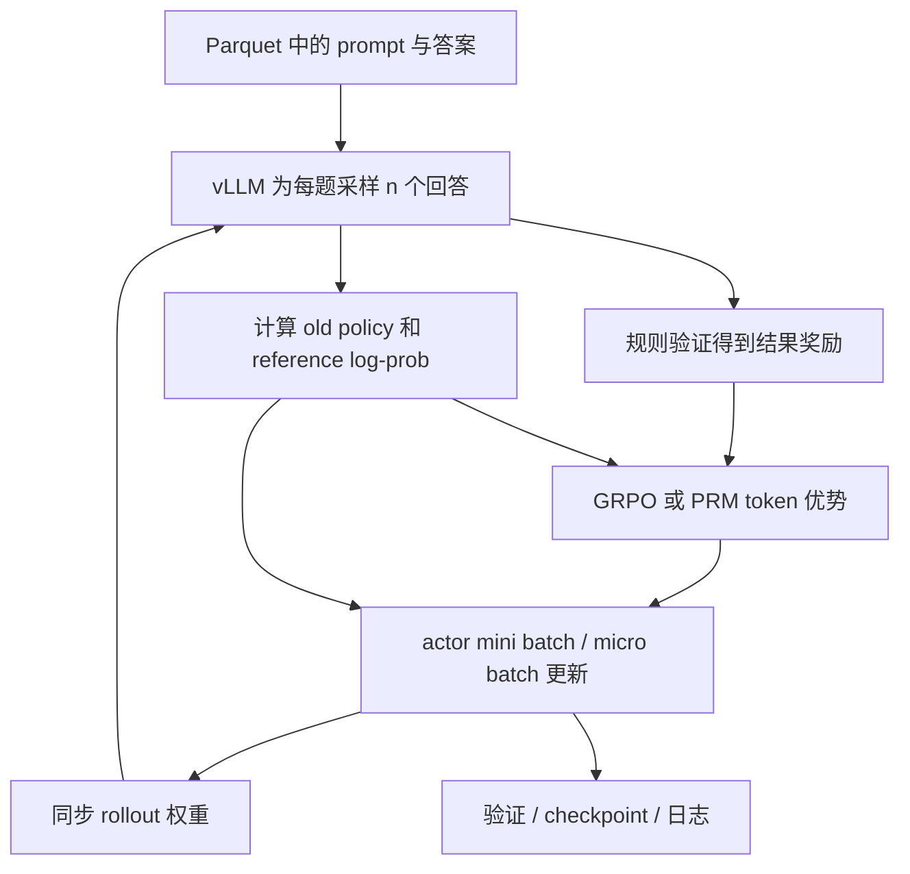

# KL-in-LLM-RL 代码实现与训练说明

本文依据本仓库提交 `8ff8a9f` 阅读整理（2026-11-19），并同步说明随后新增的 SwanLab 日志与四卡启动脚本。描述的是当前代码行为，不代表论文公式或脚本注释总与实现一致。环境安装见[训练环境配置指南](训练环境配置指南.md)。运行示例未做 GPU 实训验证。

## 1. 仓库实现什么

仓库在内置的 verl fork 上实现数学推理强化学习，核心是将相对固定参考策略的 KL 散度转化为 token 级过程信用分配。`prm` 是代码中的 advantage estimator 名称，本仓库默认配置不需要训练额外的神经网络过程奖励模型。

| 入口（相对仓库根目录） | 训练方式 | 优势与正则 |
| --- | --- | --- |
| `verl/rl-kl/train.sh` | GRPO + 显式 KL loss | 组归一化结果奖励 + actor KL 正则 |
| `verl/rl-kl/train_prl.sh` | 旧策略 future-KL / PRM | 在 trainer 中用 old policy 计算 future-KL，修正优势 |
| `verl/rl-kl/train_prl_current_policy.sh` | 当前策略 future-KL / PRL | GRPO 优势固定，actor 更新时重算修正项 |

三者均从 `python3 -m verl.trainer.main_ppo` 进入，使用 vLLM 生成、FSDP 训练。框架还带有 Megatron、SGLang、GAE 等通用功能，但这些不是默认实验路径。

## 2. 代码导航

以下链接相对本文所在的 `docs/` 目录。

| 文件 | 应重点阅读的内容 |
| --- | --- |
| [main_ppo.py](../verl/verl/trainer/main_ppo.py) | Hydra 配置、Ray 初始化、worker 与资源池选择、dataset/trainer 初始化 |
| [ray_trainer.py](../verl/verl/trainer/ppo/ray_trainer.py) | rollout、reward、old/ref log-prob、优势、更新、验证和保存的调度；`apply_prm_reward_adjustment` |
| [core_algos.py](../verl/verl/trainer/ppo/core_algos.py) | GRPO/PRM 优势、PPO loss、`prl_current_kl`、KL 估计和 future-KL |
| [utils.py](../verl/verl/trainer/ppo/utils.py) | `need_reference_policy` 自动识别 PRM/PRL 对 reference 的需求 |
| [dp_actor.py](../verl/verl/workers/actor/dp_actor.py) | 旧 worker 的 actor 前向、micro batch、反传、独立 KL loss |
| [losses.py](../verl/verl/workers/utils/losses.py) | 新 worker 的 loss 入口；向 `prl_current_kl` 传入 `ref_log_prob` |
| [ppo_trainer.yaml](../verl/verl/trainer/config/ppo_trainer.yaml) | 总配置、`algorithm`、`prm`、`trainer` |
| [actor.yaml](../verl/verl/trainer/config/actor/actor.yaml) / [dp_actor.yaml](../verl/verl/trainer/config/actor/dp_actor.yaml) | PPO、KL、PRL loss 与 FSDP 参数 |
| [rollout.yaml](../verl/verl/trainer/config/rollout/rollout.yaml) | vLLM、采样、并行和验证配置 |
| [reward_score](../verl/verl/utils/reward_score/__init__.py) / [math_verify.py](../verl/verl/utils/reward_score/math_verify.py) | 数学数据集的评分分发和答案验证 |
| [eval.py](../eval/eval.py) / [eval_metrics.py](../eval/eval_metrics.py) | 独立推理评测、分片合并和 bootstrap 统计 |

## 3. 一轮训练的数据流



1. `RLHFDataset` 读取 Parquet，构造消息；过长 prompt 被过滤。当前实现由 AgentLoop 负责 rollout 的 chat template。
2. 每题采样 `rollout.n` 个回答，共享 prompt UID，用于组内奖励归一化。
3. 数学验证产生回答级分数，再转为 token reward；经典 reward manager 将分数放在最后一个有效 response token。具体 reward loop 受配置和旧配置迁移逻辑控制。
4. old policy log-prob 用于 PPO 比率；reference log-prob 用于相对初始策略的约束。reference 不随 actor 梯度更新。
5. trainer 计算优势，actor 按 mini batch 划分优化更新、micro batch 累积梯度；动态 batch 开启时主要由 token 预算决定拆分。
6. 同步 actor 与 rollout 权重，按频率验证和保存。GRPO/PRM 默认不训练 critic。

不要混淆三类量：vLLM 的 rollout log-prob、训练侧重算的 old log-prob、actor 当前前向的 log-prob。框架支持 rollout correction，但本仓库三份脚本没有显式启用额外 correction 实验设置。

## 4. 数据与奖励

训练集由根 README 指向 `FlippyDora/dapo-filter`；验证默认是 math500。Parquet 至少需要以下语义：

```python
{
    "data_source": "dapo_filter",  # 决定 reward 路由
    "prompt": [{"role": "user", "content": "题目……"}],
    "ability": "math",
    "reward_model": {"style": "rule", "ground_truth": "标准答案"},
    "extra_info": {"index": 0, "split": "train"},
}
```

`default_compute_score` 将 `dapo_filter`、`math500`、`aime24`、`aime25` 等交给本地 `math_verify.compute_score`。它把标准答案包装为 `\boxed{...}`，解析预测与标准答案，验证等价性，正常得到 0/1 奖励。验证在 spawn 子进程池运行，默认 4 个 worker、单次等待默认 30 秒；超时默认记 0，异常打印后返回初始 0 分。缺包等错误可能表现为大量零奖励，不能只看训练是否继续运行。

`data_source` 不等同 Hugging Face 数据集 ID。任意新增字符串可能进入 `NotImplementedError`。`eval/convert_format.py` 是三个旧数据源的转换示例，其中 `math-ai/olympiadbench` 等字符串并未包含在默认训练评分路由中，不能直接当通用训练数据预处理器使用。

## 5. GRPO 与 PPO loss

令同题第 i 个回答的结果奖励为 R_i，组内均值和标准差为 μ、σ：

```text
A_i = (R_i - μ) / (σ + 1e-6)
A_i,t = A_i · response_mask_i,t
```

对应 `compute_grpo_outcome_advantage`。默认 `norm_adv_by_std_in_grpo=True`，标准差用 `torch.std` 默认样本标准差。单样本组走 μ=0、σ=1 的特殊分支，并不提供正常的组间对比信号。把该开关设为 False 时只减均值。

默认 policy loss 是 `compute_policy_loss_vanilla`：

```text
r_t = exp(clamp(log πθ,t - log πold,t, -20, 20))
l1 = -A_t · r_t
l2 = -A_t · clip(r_t, 1-εlow, 1+εhigh)
lclip = max(l1, l2)
l_t = min(-A_t · C, lclip)  if A_t < 0 else lclip
Lpg = masked_aggregate(l_t)
```

默认 εlow=εhigh=0.2，dual-clip 的 C=3；默认 `loss_agg_mode=token-mean`，不是先按序列等权平均。新 worker 还传入全局 batch 信息用于分布式归一化。

显式 KL 路径的最终目标：

```text
Lactor = Lpg - entropy_coeff · H + kl_loss_coef · Lkl
```

三份脚本的 entropy coefficient 均为 0；`train.sh` 的 `kl_loss_coef=0.01`。`algorithm.use_kl_in_reward` 则是在奖励中扣 KL，位置和梯度路径不同；它在三份脚本中均关闭。

## 6. KL 估计、方向与梯度

记 d=log πθ−log πref，w=exp(log πref−log πold)。下表给出未写数值裁剪的核心表达式；精确行为见 `kl_penalty_forward`。

| 类型 | token 前向值 |
| --- | --- |
| `kl` / `k1` | d |
| `mse` / `k2` | d²/2 |
| `low_var_kl` / `k3` | exp(−d)+d−1 |
| `k3+` | 前向同 k3，反向使用 k2 的梯度 |
| `forward_kl`（有 old_logprob，独立 actor KL loss） | w·(−d)−w+1 |
| `forward_kl`（无 old_logprob，reward 路径） | −d |

reverse 指 KL(policy || reference)，forward 指 KL(reference || policy)。k3 指数输入裁剪到 [-20,20]，输出裁剪到 [-10,10]；forward 分支也有数值保护，因此不是无限范围的无裁剪公式。`full` 分支未实现。

带 `+` 的估计使用 straight-through：`k2 - detach(k2) + detach(forward_value)`。`correct_reverseKL_is=True` 时，独立 reverse-KL loss 额外乘 `exp(log πθ−log πold)`；forward-KL 已有自己的权重，跳过该修正。脚本默认关闭。该修正权重自身没有 detach，也没有在辅助函数内作指数裁剪。

**不要把 `k3+` 的作用直接套到 PRL 优势中**：PRM 修正和 current-policy PRL 修正最终都 detach，straight-through 的差异不会通过这些优势权重反传。

## 7. future-KL 的准确实现

关键函数是 `compute_prl_future_kl`。它并非简单对所有 token KL 做包含当前位置的后缀和，而是：

```text
F_t = B_t + Σ(j>t) K_j
```

这里 K_j 是未来 token 的 KL 估计，B_t 是当前 token 的边界项。记 u=πref/πθ：

| `kl_estimator` | 未来项 K_j | 当前项 B_t |
| --- | --- | --- |
| `reverse_k1` | −log u | −log u + 1 |
| `reverse_k3` / `reverse_k3+` | u−log u−1 | −log u |
| `forward_k1` | w·log u | −u |
| `forward_k3` / `forward_k3+` | w·log u−w+1 | 1−u |

forward 的 w=πref/πsample；PRM 中 sample=old、policy=old，current-policy PRL 中 sample=old、policy=current。表中省略了指数和输出裁剪。特别是 reverse_k1 包含 `+1` 边界常数，不能把脚本注释中的简化后缀和当成精确实现。

可选处理顺序如下：

1. response mask 屏蔽无效 token。
2. `k3_future_baseline=True`：仅 k3 家族的未来尾项减去 `masked_mean(K) × 有效未来 token 数`，不改当前边界项。均值跨当前调用输入中的 batch/token，可能受 batch 划分影响。
3. `length_normalize=True`：整个 F_t 除以包含当前 token 的剩余有效 response 长度。
4. 修正项为 `clip(F_t / eta, -clip_low, clip_high)`；裁剪对象是除 eta 后的修正，而非原始 KL。

默认 eta=100，相当于修正尺度 0.01；eta 越大修正越弱。两种 PRL 脚本默认 baseline=False、length_normalize=False、clip 两侧均为 inf。

### 7.1 旧策略 PRM 路径

`algorithm.adv_estimator=prm` 时，trainer 调用 `apply_prm_reward_adjustment`：

```text
先按 prompt 组归一化结果奖励（默认 prm.adv=orm 且 rollout.n>1）
再广播为每 token 的结果优势
A_prm,t = A_orm - clip(F_t(old, ref) / eta)
```

随后 `compute_prm_outcome_advantage` 调用 `left_fill_by_next_nonzero`，把稀疏 step 值向左传播，直接作为 advantage 和 return；它不再做一次标准 GRPO 归一化，也不训练 value function。

`prm.step_split=none` 保留 token 分辨率；`length` 用 `step_len` 划分；`n` 和 `nn` 按换行/双换行，另保留最后 token。`left_fill_by_next_nonzero` 用数值零判定空位，因此恰好为零的真实优势也会被右侧非零值覆盖，这是当前实现细节。

### 7.2 当前策略 PRL 路径

脚本先用标准 GRPO 算 A，再由 `compute_policy_loss_prl_current_kl` 在 actor 当前前向上计算：

```text
A_prl,t = detach(A_grpo,t - clip(F_t(current, ref) / eta))
Lpg = DualClipPPO(r_t, A_prl,t)
```

优势修正每次 actor loss 调用重新计算，但不沿 future-KL 本身求导。它不是在 PPO 之外再次加一项独立 KL loss；因此脚本关闭 `use_kl_loss` 和 `use_kl_in_reward`。

**worker 路径限制**：总配置已默认 `trainer.use_legacy_worker_impl=disable`，使用新入口 `workers/utils/losses.py`，已向 current-policy PRL 传入 `ref_log_prob`。如果人为覆盖成 `auto/enable`，则会选择旧 `dp_actor.py`；该文件仅在 `use_kl_loss=True` 时保留 ref 字段，且调用 policy loss 时不传 `ref_log_prob`，会使 `prl_current_kl` 抛出 `ValueError`。建议显式保留 `disable`，避免切换 worker 时踩坑；新路径仍需实际 GPU 验证。仅把 KL 系数设 0 或打开 `use_kl_loss` 不能补上旧入口缺失的函数参数。

## 8. 脚本实际默认参数

以下是三个 `rl-kl/*.sh` 合并框架默认值后的关键配置；不要将 YAML 默认值与脚本覆盖混为一谈。

| 参数 | 默认 / 含义 |
| --- | --- |
| model | `Qwen/Qwen3-1.7B-Base`；脚本中 30B 注释与此不一致 |
| train batch | 256 个 prompt / iteration |
| rollout.n / validation n | 5 / 16，训练通常生成 1280 条回答 |
| prompt / response / 总长度 | 2048 / 8192 / 10240 |
| actor lr | 1e-6 |
| optimizer | AdamW；betas=[0.9,0.999]、weight decay=0.01、constant schedule、无 warmup |
| mini batch | 64；worker 进一步按 rollout.n、数据并行划分，不能直接视为最终每卡回答数 |
| micro batch / log-prob micro batch | 每卡 1；开启动态 batch，token 预算更关键 |
| token 预算 | 默认 prompt+response=10240 / GPU |
| FSDP / checkpointing | `fsdp_size=-1`；remove padding=True、gradient checkpointing=True |
| offload | actor 参数和 optimizer=True；ref 参数=True |
| rollout TP | 4 |
| rollout memory utilization | train/current-policy 为 0.6，PRM 为 0.55 |
| rollout batched tokens / max seqs | 8192 / 256 |
| rollout 采样 | temperature=1、top_p=1、do_sample=True（配置继承） |
| 资源 | 4 节点 × 8 GPU，需事先有 Ray 集群 |
| 训练时长 | total_epochs=100、显式 total_training_steps=3000；后者控制训练步数上限与调度 |
| 保存 / 验证 | 每 20 / 10 步；训练前先验证 |
| logger | console + swanlab；可通过 TRAINER_LOGGER 或 Hydra 参数覆盖 |

三条路径的主要差别：

| 参数 | train.sh | train_prl.sh | train_prl_current_policy.sh |
| --- | --- | --- | --- |
| adv_estimator | grpo | prm | grpo |
| policy_loss.loss_mode | vanilla | vanilla | prl_current_kl |
| use_kl_loss | True | False | False |
| KL loss coef / type | 0.01 / k3 | 不使用 | 不使用 |
| use_kl_in_reward | False | False | False |
| PRL 参数命名空间 | 不使用 | `prm.*` | `actor_rollout_ref.actor.policy_loss.prl_*` |

current-policy 脚本虽然也传入部分 `prm.*`，由于 adv_estimator=grpo，这些字段不负责 loss 修正；真正控制 loss 的是 `policy_loss.prl_*`。

## 9. 运行、覆盖参数、保存与评测

环境、模型与 Parquet 就绪后，从仓库根目录执行：

```bash
cd verl
export DATA_ROOT="$PWD"
export TRAIN_FILE="$DATA_ROOT/data/dapo_filter.parquet"
export MODEL_PATH=/absolute/path/to/Qwen3-1.7B-Base
bash rl-kl/train.sh \
  "data.val_files=['$DATA_ROOT/data/math500/test.parquet']" \
  trainer.nnodes=1 trainer.n_gpus_per_node=8 \
  'trainer.logger=[console]'
```

用 `train_prl.sh` 切换旧策略 PRM；用 current-policy 脚本时增加 `trainer.use_legacy_worker_impl=disable`。低资源试跑的完整参数见环境指南。

脚本支持 `MODEL_PATH`、`TRAIN_FILE`、`DATA_ROOT`、`CKPTS_DIR`、`MAX_*_LENGTH`、`ROLLOUT_*`、`VAL_N`、`OFFLOAD` 等环境变量，并支持 `PROJECT_NAME`、`EXPERIMENT_NAME`、`TRAINER_LOGGER`。`MODEL_NAME`、`TEST_FILE`、`prm_eta` 等在原入口内硬编码，不接受同名环境变量覆盖。脚本最后的 `"$@"` 可以覆盖 Hydra 字段，例如 `prm.eta=1000` 或 `actor_rollout_ref.actor.optim.lr=5e-7`；只有旧策略 PRM 脚本支持 `LR` 环境变量。追加 Hydra 覆盖后，脚本生成的实验名不自动同步，建议通过 EXPERIMENT_NAME 统一指定，必要时改保存目录。

新增的 `verl/rl-kl/train_a100_40g_4gpu.sh` 封装三个原入口，按 TRAIN_MODE 选择算法，默认单机四卡、2048/2048 长度、32 prompt batch，并修正验证路径、保存控制台日志。其具体默认值与原入口不同，见根 README 的启动示例。

`DATA_ROOT` 默认含 `~`；`TEST_FILE` 独立写死为 `~/rl-kl/verl/data/math500/test.parquet`，仅设置 DATA_ROOT 不会改验证路径。指南统一用绝对路径并显式覆盖验证集。

checkpoint 默认保存 actor model、optimizer、extra 状态，不一定是可以直接传给 vLLM 的完整 HF 目录。FSDP 导出示例（在 `verl/` 下）：

```bash
python -m verl.model_merger merge --backend fsdp \
  --local_dir /absolute/ckpts/global_step_20/actor \
  --target_dir /absolute/merged_hf
```

检查导出目录中模型配置、tokenizer 与权重是否齐全。继续训练可用 `trainer.resume_mode=auto` 从相同保存目录恢复，或使用 `resume_mode=resume_path` 与 `trainer.resume_from_path=/absolute/ckpts/global_step_20`；恢复依赖原保存的状态文件。

独立评测从仓库根目录运行：

```bash
python eval/eval.py --model /absolute/merged_hf \
  --data math500=/absolute/data/math500/test.parquet \
  --output-dir eval/results --output-name math500_run \
  --n 16 --temperature 1.0 --max-response-length 8192 \
  --max-model-len 10240 --tp 1 --dp 1
python eval/eval_metrics.py --file eval/results/math500_run.jsonl \
  --k 16 --n_bootstrap 100 --seed 42
```

`eval.py` 报告 pass@n（每题至少一条正确）和 mean@n（采样回答平均正确率），支持 `--num-shards`、`--shard-rank`、`--merge-shards`。`eval_metrics.py` 的 pass@k 通过有放回 bootstrap 得出，不应当作无偏组合估计量。`eval/run.sh` 带 `<model_path>`、`<output_name>` 占位符及固定虚拟环境路径，需要替换；推荐直接使用上述 Python 命令。

## 10. 复现实验时要记录什么

保存代码 commit、最终 Hydra 配置、模型/tokenizer revision、数据版本、环境 freeze、GPU 数与显存、随机种子、训练与评测模板、长度限制、KL 方向/估计器/eta、worker 路径。尤其注意开启 length normalization、改变 step 分割或 batch 相关 k3 baseline，都会改变训练行为，不能仅按实验名称判断两次训练是否相同。
